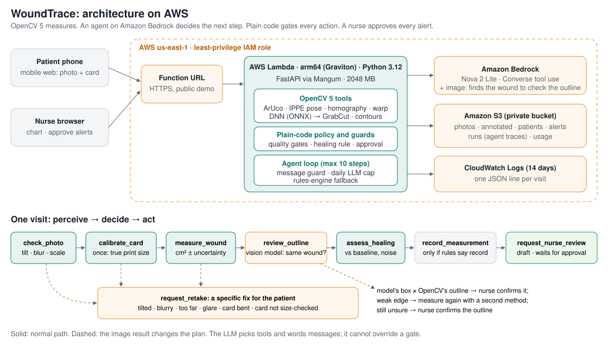

# WoundTrace

**Measure a wound from a phone photo. An agent checks the photo, measures the area in cm² with its
uncertainty, and asks a nurse to review when healing stalls. A human approves every alert.**

Built for the OpenCV AI Competition 2026 (powered by AWS). OpenCV 5 does the measuring; an agent on
Amazon Bedrock decides the next step; plain code gates every action.

- **Live demo:** https://asme326si3qdbv4raxgm4fbbge0fohve.lambda-url.us-east-1.on.aws/
- **Technical report:** [REPORT.md](REPORT.md) (method, evaluation, failure cases, limitations)
- **Video:** _link added on submission_

> Measurement aid, not a diagnosis. No real patient images were used: demo patients are printed or
> synthetic test targets, and the real-photo tests use printed targets and a coin.

## Why

Home-care nurses track chronic wounds by area over time, but a paper ruler's length × width overestimates
irregular wounds (by +44% on our test set), photos sent from home are often tilted, blurred or lit by a
flash, and a card printed at home is often printed at the wrong size. WoundTrace turns one phone photo next
to a printed card into a trustworthy number, or a specific instruction to take a better one.

## Try it (2 minutes, no printer needed)

1. Open the live demo. On **Patient**, click a sample photo and watch the agent's trace on the right.
   - *Patient A · tilted* or *flash glare*: the agent asks for a retake and says exactly what to change.
   - *Patient A · good photo*: measured, compared with 4 weeks of history, **stalled** → a nurse note is
     drafted and waits for approval.
   - *Patient C · card not checked* → the agent asks for a one-time card check; *Patient C · with a bank
     card* → it finds the plastic card, sees the printer shrank the card to 92%, and corrects the area.
2. **Nurse**: approve or dismiss the drafted note; see each patient's trend with ± error bars.
3. **How it works · evidence**: the architecture and every evaluation number, generated from the eval files.

With a printer: print `print/card-only.png` at 100% (black ink is enough), lay it flat next to the
target, and photograph from straight above.

## Results (details and failure cases in [REPORT.md](REPORT.md))

| Test | Result |
|---|---|
| Synthetic photos with known area, held-out set (750; tilt 0-60°, blur, glare, 6 skin tones) | 1.4% mean area error when recorded; **0** recorded with error > 10% |
| Same photos with the quality gates switched off | 14.5% mean error |
| Stated uncertainty (± 2 sd), held-out | contains the true area 96.6% of the time (target 95%) |
| Card printed at 92.5%, corrected with a plastic card (60 agent visits) | measured scale 0.921; recorded area error 1.0% |
| Real phone photos with known area (26: printed targets + a coin) | card found 26/26; 7 recorded, 1 of them > 10% off |
| Agent on Bedrock vs the clinic's rules (60 visits, 10 scenarios) | same outcome **60/60**; 0 guard refusals; 2 replies replaced |

## How it works



- **OpenCV 5** (`app/vision.py`): ArUco detection with sub-pixel corners, IPPE pose (tilt), homography
  residual (card flat), marker edge width (blur in mm), perspective rectification to true millimetres,
  Lab colour distance with an edge-seeking threshold, slough handling and GrabCut refinement, contour
  metrics (area, Feret length, width, perimeter), glare, and a plastic-card (ID-1) detector for the print
  scale.
- **Agent** (`app/agent.py`, `app/tools.py`): Bedrock Converse with 8 tools. The model picks the next tool
  and writes the messages. Plain code refuses anything the clinic's rules don't allow: measuring a failed
  photo, recording without a "record" decision or an unchecked card, retaking a measurable photo, and
  sending any nurse note without human approval. A message guard checks every reply before the patient
  sees it. If Bedrock fails or the daily cap is reached, a rules engine runs the same tools.
- **AWS**: Lambda (arm64 Graviton, Python 3.12) behind a Function URL, a private S3 bucket, Bedrock
  (Nova 2 Lite), CloudWatch Logs with one JSON line per visit, a least-privilege IAM role.

## Run it locally

```bash
./run.sh setup        # venv + pinned dependencies (requirements-dev.txt)
./run.sh              # http://127.0.0.1:8100 · rules engine, local storage, no AWS needed
./run.sh test         # 14 offline tests
venv/bin/python -m scripts.demo_data seed   # demo patients A, B, C in data/store
```

Use the Bedrock agent locally (needs AWS credentials with access to Nova 2 Lite in us-east-1):

```bash
USE_BEDROCK=1 AWS_DEFAULT_REGION=us-east-1 ./run.sh
```

## Reproduce the evaluation

```bash
venv/bin/python -m eval.run_eval --seed 2026          # tuning seed (gates, uncertainty fit)
cp eval/results.json /tmp/fit.json
venv/bin/python -m eval.run_eval                      # held-out seed 11: eval/summary.md (~4 min, 12 cores)
venv/bin/python -m eval.fit_uncertainty /tmp/fit.json eval/results.json eval/uncertainty.json
AWS_DEFAULT_REGION=us-east-1 venv/bin/python -m eval.agent_eval   # 60 Bedrock visits, ~$0.30
venv/bin/python -m eval.calibration_eval > eval/calibration_summary.md   # misprinted card
venv/bin/python -m scripts.real_eval                  # needs real/ photos (see below)
venv/bin/python -m scripts.evidence                   # web/evidence.json for the app
```

The real phone photos were taken in a private home and are not published; their per-photo results are in
`real/summary.md` and `real/results.json`.

## Deploy to AWS

```bash
aws login                     # AWS CLI v2
./deploy/aws.sh seed          # bucket, IAM role, Lambda + Function URL, log group, demo patients
```

Idempotent; prints the live URL. It creates one private S3 bucket, one IAM role (its own log group, its
bucket's data prefixes, Nova 2 Lite only), one Lambda function with a public Function URL, and a log group
with 14-day retention. Cost: about $0.005 of Bedrock per agent visit (≈13k input and 235 output tokens),
capped at 150 visits a day; Lambda and S3 stay within the free tier at demo volume.

Settings (environment): `BEDROCK_MODEL`, `AGENT_ENGINE` (`bedrock`/`rules`), `DAILY_LLM_RUNS`,
`STALL_DAYS` and `STALL_REDUCTION` (healing rule, default 28 days / 50%), `BUCKET`, `DATA_DIR`.

## Repository

| Path | What |
|---|---|
| `app/vision.py` | OpenCV 5: card, quality checks, rectification, segmentation, metrics, card calibration, uncertainty |
| `app/policy.py` | The clinic's rules: quality and outline decisions, healing rule |
| `app/tools.py` · `app/agent.py` | The 8 agent tools with their guards; the Bedrock loop, rules engine and message guard |
| `app/synth.py` · `app/card.py` | Synthetic targets and simulated phone photos with known area; the printed card |
| `app/main.py` · `web/index.html` | FastAPI routes; the single-page app (patient, nurse, evidence) |
| `eval/` | Synthetic, uncertainty and agent evaluations with their results |
| `real/summary.md` | Real phone photos of printed targets and a coin |
| `scripts/` | Demo data and printable sheets, real-photo evaluation, evidence file |
| `deploy/aws.sh` | One-command AWS deployment |
| `tests/` | Offline tests (rules engine, temporary storage) |

Dependencies are pinned in `requirements.txt` (runtime, also bundled into Lambda) and
`requirements-dev.txt` (server, tests).

## Responsible use

WoundTrace measures; it does not diagnose, predict an individual outcome or recommend treatment. Its
healing flag follows a guideline threshold and only prompts a clinician review, and every nurse note is a
draft until a human approves it. It has **not** been validated on real wounds; see the limitations in the
report and on the app's evidence page.

## Credits

Built by aryan-neopane (solo). The FastAPI app skeleton comes from our own starter kit, written before this
event. OpenCV 5, FastAPI, Mangum, NumPy, boto3. MIT licence (`LICENSE`).
