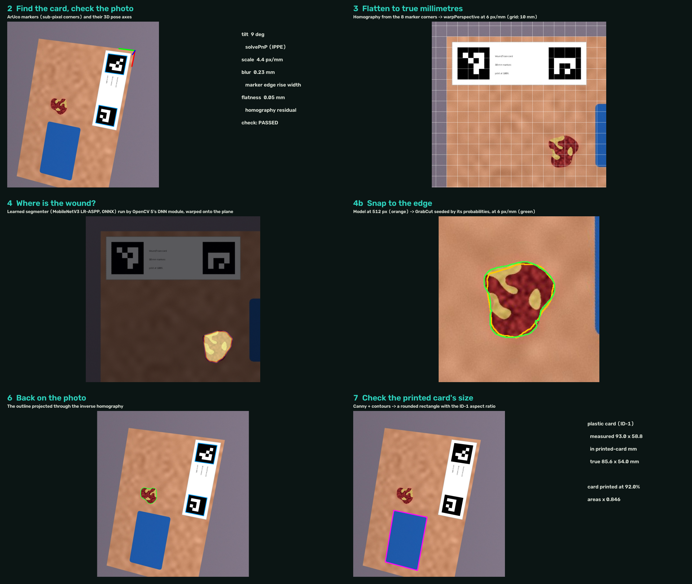

# WoundTrace: technical report

OpenCV AI Competition 2026 · solo entry by aryan-neopane · live: https://asme326si3qdbv4raxgm4fbbge0fohve.lambda-url.us-east-1.on.aws/

## 1. Problem and users

Chronic wounds are common and growing: Medicare beneficiaries with a wound rose from 8.2 million in 2014 to
10.5 million in 2019 (Carter et al. 2023; the two years used different Medicare data sets) [3]. Between
visits, home-health and wound-clinic nurses track wounds by area. Two numbers matter: how big the wound is,
and how much it has shrunk. For diabetic foot ulcers, the Society for Vascular Surgery recommends
considering adjunctive therapy when the area has not fallen by more than 50% after at least 4 weeks of
standard care [1]; the 4-week change predicts 12-week healing (Sheehan et al. 2003, n = 203) [2].

Measuring at home fails in three ways: a ruler's length × width overestimates irregular wounds; phone photos
are tilted, blurred or lit by a flash; and a card printed at home is often printed at the wrong size.
**User:** a nurse following patients who send photos from home. **Promise:** one photo next to a printed card
becomes an area in cm² with its uncertainty, or a specific instruction to take a better photo; stalled
healing becomes a drafted note that the nurse approves.

## 2. What it does

One visit (diagram: [docs/architecture.svg](docs/architecture.svg)):

1. `check_photo`: find the card, estimate tilt, blur, resolution, flatness, brightness. Fail → `request_retake`
   with the specific fix ("hold the phone flat", "tap to focus", "turn off the flash").
2. `calibrate_card` (once per printed card): find a plastic bank/library card in the photo and measure the
   printed card's true size. None found → ask once for it, or for a ruler reading of one black square.
3. `measure_wound`: rectify to true millimetres, outline the wound, measure area ± uncertainty, length,
   width, perimeter; the clinic's rules decide record, retake (glare), measure again with a second method
   (weak edge), or ask the nurse to confirm the outline.
4. `review_outline`: the vision model marks the wound on the plain photo; if its box and OpenCV's outline
   disagree, the outline goes to the nurse instead of the record.
5. `get_history`, `assess_healing`: compare with baseline and last visit. Growth counts as worsening only if
   it exceeds 10% **and** the measurement noise of both photos.
6. `record_measurement`; `request_nurse_review` drafts a note (numbers, uncertainty, "photo measurement, not
   a diagnosis") that waits in the nurse queue until a human approves it.

## 3. OpenCV 5 pipeline (`app/vision.py`)

- **Card:** two 30 mm ArUco markers (`DICT_4X4_50`), `ArucoDetector` with sub-pixel corner refinement.
  Eight corners → `findHomography` to card millimetres; its RMS residual (mm) checks the card is flat.
- **Quality:** tilt from `solvePnP` (IPPE, assumed phone focal length); blur as the 10-90% rise width of the
  markers' outer edges, sampled along normals with `remap`, in mm; resolution in px/mm; brightness of the
  card's white strip. Gates: ≥ 2.5 px/mm, tilt ≤ 45°, edge ≤ 1.3 mm, residual ≤ 0.6 mm, brightness ≥ 70.
- **Rectification:** `warpPerspective` onto the skin plane at 6 px/mm.
- **Segmentation (default):** a learned segmenter (LR-ASPP, MobileNetV3-Large; [model card](app/models/README.md))
  exported to ONNX and run by `cv2.dnn` on the whole photo at 512 px; no PyTorch at runtime. Its probability
  map is warped onto the plane with the same homography, and `grabCut` seeded from it (sure > 0.9, likely
  > 0.5, background beyond 8 mm) snaps the outline to the colour edge at 6 px/mm. The most confident
  component that is off the card and not cut by the frame is the wound. Trained on the FUSeg train split
  plus 500 synthetic photos (`eval/train_segmenter.py`, ~1 h on a GTX 1660 Ti).
- **Segmentation (classical, the cross-check):** Lab distance from the skin colour, a background-free Otsu
  split, a ring skin sample, an edge-seeking threshold (strongest Sobel boundary of 16), slough handling,
  then `grabCut`. Line-like or thin shapes (aspect > 8 or nothing ≥ 3 mm across, from `minAreaRect` and
  `distanceTransform`) are not wounds.
- **Measurement:** area, maximum Feret length and perpendicular width (convex hull), the ruler's L × W,
  perimeter, solidity, glare fraction, and edge contrast across the boundary.
- **Card calibration:** rectify a wide window, `Canny` + `findContours`, keep rounded rectangles with the ID-1
  aspect ratio (85.60 × 53.98 mm); average the inner and outer contour of the edge line; print scale = true
  size / measured size, both sides must agree within 2.5%. The plastic card is masked out of segmentation.
- **Uncertainty:** relative sd² = k0² + (k1 · perimeter · (edge blur + pixel size) / area)² + (k2 · card residual)²,
  fitted by maximum likelihood on the tuning seed (k0 = 0.0039, k1 = 0.205, k2 = 0).

## 4. Agent (`app/agent.py`, `app/tools.py`)

Amazon Bedrock Converse with tool use (Nova 2 Lite), up to 10 steps, 9 tools. The model chooses tools and
words messages; plain code enforces the rules: no measuring a failed photo, no recording without a "record"
decision or an unchecked card, no retake for a measurable photo, ids pinned to the visit, nurse notes queued
for approval. **Outline check** (`app/review.py`): the same model is shown the plain photo (never OpenCV's
outline) and asked for the wound's bounding box; code computes the IoU with the outline's box and a value
below 0.1 sends the outline to the nurse. A Bedrock visit cannot record before this check. An **outgoing-message guard** checks each patient reply for leaked internals, clinical opinions
("looks good") and length, and substitutes the template message if it fails. A deterministic rules engine
runs the same tools when Bedrock is unavailable or the daily cap (150 visits) is reached; the UI always says
which engine ran. Each visit is stored as a trace in S3 and logged as one JSON line to CloudWatch.

## 5. Evaluation

**Real wounds: outline** (`eval/fuseg_summary.md`). FUSeg 2021 validation split: 200 de-identified clinic
photos of foot ulcers with wound-care experts' masks, never used in training or model selection. No card
in these photos, so only the outline is tested.

| Method | Mean Dice | Dice ≥ 0.7 | Missed |
|---|---|---|---|
| Classical colour + GrabCut (my first pipeline, tuned on synthetic) | 0.033 | 2% | 97 |
| Learned segmenter alone | 0.824 | 86% | 1 |
| Learned + GrabCut snap (default) | **0.843** | 88% | 2 |

Examples at the 90th, 50th and 10th percentile: [docs/fuseg_examples.png](docs/fuseg_examples.png).

**Outline check** (`eval/review_summary.md`). 261 outlines on the same photos (learned and classical, so
both good and bad ones), excluding the 40 used to design the check. Good: Dice ≥ 0.7; bad: < 0.4.

| Outlines | Passed | Sent to the nurse |
|---|---|---|
| Good (159) | 72% | 28% |
| Bad (86) | 21% | **79%** |

**Synthetic photos with known area.** `app/synth.py` draws an irregular wound (granulation, slough, periwound
redness) on one of six skin tones and photographs it with a simulated camera (perspective, distance,
defocus, flash glare, noise, JPEG); the true area is exact. Seed 2026 tuned the gates and the uncertainty;
seed 7 was used to diagnose failures; **seed 11 is held out** (600 hard + 150 clean photos).

| Synthetic, held-out | Result |
|---|---|
| Recorded / retake / nurse outline (hard set) | 245 / 355 / 0 |
| Mean area error when recorded · 95th percentile | 1.2% · 4.4% |
| Recorded with error > 10% | 1 |
| Same pipeline with gates off · clean set | 8.0% · 0.5% mean error |
| Ruler L × W vs true area | +42.9% |
| Error by skin tone 1 → 6 (light → dark) | 1.5 · 1.4 · 1.1 · 0.8 · 1.0 · 1.2% |
| True area inside ± 1 sd / ± 2 sd | 85.9% / 98.2% (targets 68% / 95%; constants fitted with the classical outline, slightly wide now) |

**Real phone photos with known area** (26 iPhone photos, room light; `real/summary.md`). Not wounds: colour
sheets A and B from a faulty printer (banding), a black-ink sheet, and a $1 coin (25.00 mm). Card found
26/26. Recorded 6, all within 10% (mean 6.3%; −7.1 to −9.0% on sheet B, +1.7% black ink, +5.7 and +6.1%
on the coin, about 4-5% of which is its 3 mm thickness); 12 sent to the nurse, 8 retakes (4 of them because
the model found no wound on the striped sheet A). Only 1 of the 6 fell inside its ± 2 sd.

**Card calibration** (`eval/calibration_summary.md`). In 12 synthetic photos with cards printed at 92.5-104%
and tilts of 5-35°, the plastic card was found in 11 (missed at 35°, which leads to a retake); corrected
areas were within 2.6% of the truth (uncorrected: up to +18%).

**Agent on Bedrock** (`eval/agent_summary.md`): 60 visits, 10 scenarios × 6 skin tones, each also run through
the rules engine from the same state.

| Result | Value |
|---|---|
| Same outcome as the rules (record / retake / which nurse request) | 60/60 |
| Outline check on the 29 visits that measured a wound | agreed 29/29 (synthetic photos) |
| Tool calls refused by the guards | 0 |
| Numbers in patient messages that came from tool outputs | 100% |
| Replies replaced by the message guard | 1 |
| Latency per visit, median / p95 | 4.8 / 7.7 s |
| Tokens per visit, input / output | 16,169 / 236 (≈ $0.006 at third-party listed Nova 2 Lite prices [5]) |

The agent run used the card printed at 92.5%: measured scale 0.921, recorded area error 0.8%.

## 6. Failure cases found, and what changed

1. **The classical pipeline failed on real wounds.** Tuned on synthetic targets, it scored 1.4% area error
   there, then Dice 0.03 on real foot ulcers, missing 97 of 200: real wound beds, callus, toes and bedding
   break a colour rule. Replaced as the default by the learned segmenter (Dice 0.84); kept as a cross-check.
2. **The outline check passed everything.** First design: show the model the photo and the outline overlay
   and ask whether it follows the wound. It answered "follows" for 100% of good **and** 100% of bad outlines
   (`eval/review_overlay_summary.md`). Redesigned so the model never sees the outline: it marks the wound
   itself and code compares. Now 79% of bad outlines are caught, at the cost of 28% false alarms.
3. **Dark skin, slough only** (classical, seed 7): 7 photos recorded 64-98% too small on skin tones 4-6.
   Fixed with a background-free re-split, a ring skin sample and a deep-core rule.
4. **Printed text measured as a wound** (real sheet A): line and thickness filters plus a policy backstop.
5. **Misprinted card.** The coin read +24.5% because the printer shrank the card to 92.3% (confirmed with a
   ruler); the photo looks perfect. Added card calibration; nothing is recorded until the card is checked.
6. **Agent reasoning sent to patients.** In the first agent run, 16/60 retake replies were the model's
   working notes and 2 said "your wound looks good". Added the message guard and use the model's own
   `request_retake` message.
7. **Conservative gates.** 216 of 322 measurable retakes would have measured within 5%: the gates trade
   patient effort for few bad accepts. Loosening them needs real-wound data with known area.

## 7. Limitations

- **Area accuracy on real wounds is untested.** The real-wound test is the outline on clinic photos of foot
  ulcers without a card; patients' own photos, other wound types, depth and curved limbs are untested, and
  FUSeg does not report skin tone, so fairness across skin tones is only tested on synthetic skin.
- The outline check sends 28% of good outlines to the nurse; the ± range is too narrow on real photos (1/6).
- Area only: no depth or volume, no tissue classification. Tilt uses an assumed focal length; the card must
  lie in the wound's plane.
- The healing threshold comes from diabetic foot ulcer evidence; for other wounds it is a configurable prompt.

## 8. Responsible use

A measurement aid, never a diagnosis, outcome prediction or treatment recommendation. Every nurse note is
a draft until a human approves it; the patient-facing text is checked by code. Real wound photos come only
from a public, de-identified research dataset (FUSeg [6]); it is not redistributed here, and three cited
examples appear in a figure. The author's own test photos are kept out of the repository. The S3 bucket is private, the Lambda
role has least privilege, logs are kept 14 days, and Bedrock use is capped per day.

## 9. References

1. Hingorani A, et al. The management of diabetic foot: a clinical practice guideline by the Society for
   Vascular Surgery, APMA and SVM. J Vasc Surg 2016;63(2 Suppl):3S-21S.
2. Sheehan P, et al. Percent change in wound area of diabetic foot ulcers over a 4-week period is a robust
   predictor of complete healing in a 12-week prospective trial. Diabetes Care 2003;26(6):1879-82.
3. Carter MJ, et al. Chronic wound prevalence and the associated cost of treatment in Medicare
   beneficiaries: changes between 2014 and 2019. J Med Econ 2023;26(1):894-901.
4. ISO/IEC 7810: ID-1 card format, 85.60 × 53.98 mm.
5. Amazon Nova 2 Lite on Bedrock, about $0.33 / $2.75 per million input / output tokens (us. inference
   profile), from third-party price trackers; check AWS pricing.
6. Wang C, et al. Fully automatic wound segmentation with deep convolutional neural networks. Sci Rep
   2020;10:21897; and the Foot Ulcer Segmentation Challenge (FUSeg), MICCAI 2021. Photos: AZH Wound and
   Vascular Center, shared by the authors with the clinic's permission.
